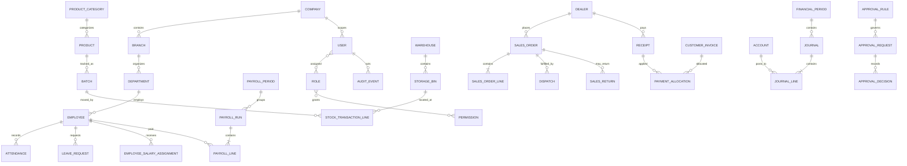
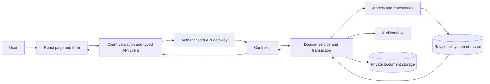
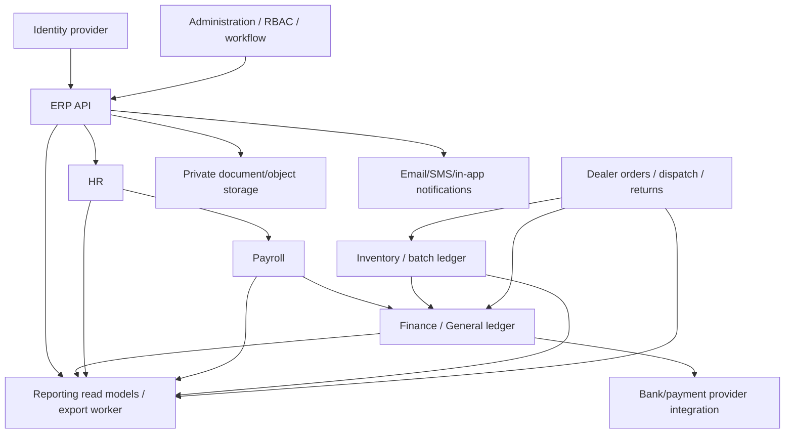

# GreenField Pesticide ERP — Technical Audit

**Audit scope:** repository source present in this workspace, reviewed 11 November 2026  
**System reviewed:** React 18 + Vite frontend (`greenfield-pesticide-erp`)  
**Evidence standard:** “Observed” means present in this repository. “Recommended” is a proposed target, not a description of a deployed service.

> **Scope limitation:** This repository contains a browser UI only. It has no backend source, API specification, database schema, ORM/model definitions, migrations, authentication provider, or server configuration. Consequently, the database, controller/service, endpoint, API response, and authentication sections below distinguish verified absence from a recommended design. A frontend feature name is not evidence that a corresponding server capability exists.

## Executive summary

- Seven ERP modules are represented: Administration, Dealer Management, Finance & Accounting, Human Resource, Inventory & Warehouse, Payroll, and Reports & Analytics.
- There are 206 JSX files under `src/pages` (including module containers and shared components) and 201 declared page-route entries. The label **Dealer Reports** is used in both Dealer Management and Reports & Analytics, with context-sensitive routing.
- The application uses one React Router catch-all route and resolves internal paths through module-specific maps in `App.jsx`. Page screens are selected by module containers and conditionals/maps.
- No HTTP client or network request call is implemented in the source reviewed (`fetch`, Axios, XHR, or equivalent). The UI operates on seeded in-memory data and, for selected modules, browser `localStorage`.
- There are no backend models or tables to inventory. Model/ERD material later in this report is a suggested normalized design.
- The production build succeeds. Vite warns that the main JavaScript chunk is approximately 517 kB minified (134 kB gzip).

## 1. Module analysis

| Module | Purpose and observed features | Connected modules / data coupling in UI | Dependencies | Missing integrations and suggested integrations | API required? |
|---|---|---|---|---|---|
| **Administration** | Company/profile and documents; branches; departments and employee assignments; users, roles and permission matrix; approvals, rules, delegations and limits; financial year, numbering, company/system settings and audit views. | Shares branch, department, employee, user, role, approval and settings state in `App.jsx`; HR and Payroll receive shared employee/branch/department data. Audit screen combines system, login and approval history. | React, React Router, Lucide; shell-owned state and browser storage. | No identity provider, authorization enforcement, company/branch master service, document service, audit service, or durable approval workflow. Integrate centralized identity/RBAC, tenant/company and branch master data, workflow/notification, file storage and immutable audit. | **Yes** — multi-user access, permissions, approvals, audit, configuration and shared master data must be server authoritative. |
| **Dealer Management** | Dealer onboarding/profile/category/verification; territory and officer assignments; orders/approval; dispatch/delivery/returns; dealer credit, payment and statements; performance and sales reports. | Conceptually connects to Inventory (products, availability, batches), Finance (receivables, receipts), Administration (branches, users, approvals), and Reports. Current module computes dealer balances from local orders, posted payments and approved returns. | React, local module controller, seeded catalog and `localStorage`. | No shared customer/dealer master API, order-to-inventory reservation, dispatch/shipment tracking, returns-to-stock disposition or invoice/payment posting to Finance. Integrate these with shared identifiers and transaction boundaries. | **Yes** — order, credit and inventory operations require concurrency control, server rules, audit and financial correctness. |
| **Finance & Accounting** | Chart of accounts, journals/drafts/postings/reversals, cash and bank, receipts/payments, AR/AP, allocations, bank reconciliation and financial statements. | Intended connections to Dealer (customer balances/receipts), Inventory/Procurement (stock receipts and supplier bills), Payroll (salary journals/payments), Administration (financial years, numbering, approvals) and Reports. | React, finance shared components, seeded data and `localStorage`. | No ledger service, posting/period locks, bank feed, supplier/customer subledger API, payroll journal integration, tax engine or authoritative reporting. Integrate a double-entry ledger with posting rules and idempotent source-document posting. | **Yes** — financial ledger must be transactional, auditable, permissioned and consistent across users. |
| **Human Resource** | Employee directory/profile/documents; attendance and corrections; shifts/rosters; leave; performance, reviews and goals; employee reports. | Shares employee/branch/department entities with Administration and Payroll; shares local employee state and HR state in browser storage. | React, HR shared components, seeded employees and `localStorage`. | No authoritative employee service, attendance device integration, document storage, leave accrual/payroll handoff, identity provisioning or notification workflow. Integrate with Administration, Payroll and an optional attendance provider. | **Yes** — personal data, multi-user access, durable records, leave balance integrity and payroll dependencies. |
| **Inventory & Warehouse** | Product and category/unit setup; warehouses/bins; opening stock, GRN, issues, transfers and adjustments; batch/expiry/QC; stock counts/approvals; reports/valuation. | Intended connections to Dealer orders/dispatch/returns, Finance AP/GL, Administration branches/approvals, and Reports. Local controller derives available stock from batches, quality and expiry. | React, inventory shared components, seeded catalogs and `localStorage`. | No authoritative stock ledger, purchasing/supplier receipt integration, reservation/fulfillment, return disposition, lot traceability persistence, valuation posting or warehouse synchronization. Integrate transactionally with Dealer and Finance. | **Yes** — stock is shared mutable state; batch traceability and accounting valuation need server transactions and audit. |
| **Payroll** | Salary structures and components; employee assignments; pay periods and generation/review/finalization; payment records/slips; advances/loans and reports. | Reads employees from HR; depends on employee/job/salary setup, attendance/leave and Administration approvals; should post expense/liability and payments into Finance. | React, payroll shared components, seeded data and `localStorage`. | No actual payroll engine, tax/statutory rules, attendance/leave import, payout gateway, payslip service or Finance posting. Integrate HR, Finance and jurisdiction-specific payroll rules with controlled approvals. | **Yes** — confidential compensation, calculations, approvals and payment ledgers require access controls and server-side processing. |
| **Reports & Analytics** | Executive/module overviews, operational reports, saved reports, filters, scheduling/export history, audit and transaction analysis. | Reads/aggregates fixture data for dealer, finance, inventory, HR, payroll and Administration. | React, shared report UI, seeded records and `localStorage`. | No reporting API, data warehouse, scheduled-job worker, delivery service, export archive or cross-module authoritative dataset. Integrate authorized reporting read models and scheduled export jobs. | **Yes** — reports must reflect durable data, enforce row-level access and scale without loading transactional UI state. |

### Orphan, duplicate, unused and broken-connection observations

- **Orphan module:** None of the seven top-level modules is wholly unreferenced; all are listed in the shell navigation, have route/navigation definitions and are rendered through `App.jsx`.
- **Orphan/ungrouped screens:** Several route entries are not in their module’s visible navigation set: Administration `Dashboard`, `Company Setup`, `Edit Department`, `Edit User`; Dealer `Dealer Management`, `Dealer Dashboard`; Finance `Finance Dashboard`; HR `Human Resource Dashboard`, `Edit Employee`; Inventory `Inventory Dashboard`; Payroll `Payroll Dashboard`; Reports `Reports & Analytics`. Some are likely deliberate landing/edit states, but direct accessibility should be verified.
- **Duplicate functionality:** `Dealer Reports` is a duplicate page label across Dealer Management and Reports & Analytics; `pagePath` special-cases it using module context. Multiple module-specific report pages and central Reports operational pages overlap in subject matter. Approval queues/history exist in both Administration and Dealer order workflow; the UI has a shared Administration approval data set but Dealer order approval is also represented in its own local dataset. These overlaps need a single source of truth and explicit ownership.
- **Feature/action gaps:** The dashboard ribbon’s `Production` action does not map to a routable page and falls through to a generic modal. Dashboard `Payment` and `Dealer List` are labeled as Inventory/Finance ribbon sections while routing to Dealer screens. Quick-action modal submit only closes the modal and displays a success toast; it is not evidence of a persisted transaction.
- **Route/component risks:** The internal URL resolver accepts generic `/pages/<encoded name>` fallback paths for routable labels, while module maps separately define canonical paths. The route arrays and navigation sets are maintained independently, creating drift risk. A catch-all router means unmapped screens are not rejected by a dedicated route table. `Dealer Reports` requires context to resolve its ambiguous label.
- **Unused features:** No reliable static “unused” determination is possible solely from presence of page files. Some route components are reachable only as direct/edit/landing states rather than visible navigation items; see above. A full runtime link-coverage test is recommended before deleting anything.
- **Broken integrations:** No external system integrations or backend integrations were found. This is a material implementation gap rather than a failed configured connection.

## 2. Page structure, routes, fields and actions

### How to read this catalog

- The route column lists the canonical internal URL from the module route map; the app’s actual React Router declaration is a wildcard (`*`) and the shell resolves these paths itself.
- `*` means the source visibly marks a field required or applies explicit validation; `?` means no explicit required marker was established (not necessarily optional). If a required marker is visual only, do not assume server/browser validation.
- `text`, `email`, `tel`, `number`, `date`, `month`, `time`, `range`, `select`, `checkbox`, `textarea`, `file`, `read-only` are source-visible control kinds. Search inputs are included among fields. “—” means no page-owned form input found; the view may still have row actions/navigation.
- Reusable module controllers sometimes render fields, filters and grids on behalf of route components. Where the source did not make a field label or type determinable, this is stated rather than guessed. Table columns are given where visible in the reviewed page/shared code.
- The exhaustive form/control inventory follows the route catalog. Screens with no form inputs are explicitly grouped by module, so field count for those page-owned inputs is **0**. Dynamic module-level filters are not counted as page-owned fields.

### 2.1 Canonical route catalog

#### Administration — `/pages/administration`

| Page | Canonical route |
|---|---|
| Dashboard | `/pages/administration/dashboard` |
| Company Setup | `/pages/administration/company-management/company-setup` |
| Company Documents | `/pages/administration/company-management/company-documents` |
| Branch List | `/pages/administration/branches/branch-list` |
| Create Branch | `/pages/administration/branches/create-branch` |
| Branch Details | `/pages/administration/branches/branch-details` |
| Branch Settings | `/pages/administration/branches/branch-settings` |
| Branch Reports | `/pages/administration/branches/branch-reports` |
| Department List | `/pages/administration/departments/department-list` |
| Create Department | `/pages/administration/departments/create-department` |
| Edit Department | `/pages/administration/departments/edit-department` |
| Department Details | `/pages/administration/departments/department-details` |
| Department Settings | `/pages/administration/departments/department-settings` |
| Assign Employees | `/pages/administration/departments/assign-employees` |
| Department Reports | `/pages/administration/departments/department-reports` |
| Users List | `/pages/administration/users-and-roles/user-list` |
| Create User | `/pages/administration/users-and-roles/create-user` |
| Edit User | `/pages/administration/users-and-roles/edit-user` |
| User Profile | `/pages/administration/users-and-roles/user-profile` |
| Roles Management | `/pages/administration/users-and-roles/roles-management` |
| Permission Matrix | `/pages/administration/users-and-roles/permission-matrix` |
| Login History | `/pages/administration/users-and-roles/login-history` |
| Pending Approvals | `/pages/administration/approval-management/pending-approvals` |
| Approval Rules | `/pages/administration/approval-management/approval-rules` |
| Approval History | `/pages/administration/approval-management/approval-history` |
| Delegation & Limits | `/pages/administration/approval-management/delegation-limits` |
| Company Settings | `/pages/administration/system-settings/company-settings` |
| General Settings | `/pages/administration/system-settings/general-settings` |
| Financial Year | `/pages/administration/system-settings/financial-year` |
| Document Numbering | `/pages/administration/system-settings/document-numbering` |
| Audit Logs | `/pages/administration/system-settings/audit-logs` |

#### Dealer Management — `/pages/dealer-management`

| Page | Canonical route |
|---|---|
| Dealer Management | `/pages/dealer-management/dashboard/dealer-management` |
| Dealer Dashboard | `/pages/dealer-management/dashboard/dealer-dashboard` |
| Dealer List | `/pages/dealer-management/dealer-management/dealer-list` |
| Add Dealer | `/pages/dealer-management/dealer-management/add-dealer` |
| Dealer Profile | `/pages/dealer-management/dealer-management/dealer-profile` |
| Dealer Verification | `/pages/dealer-management/dealer-management/dealer-verification` |
| Dealer Categories | `/pages/dealer-management/dealer-management/dealer-categories` |
| Dealer Reports | `/pages/dealer-management/dealer-management/dealer-reports` |
| Sales Territories | `/pages/dealer-management/territory-assignments/sales-territories` |
| Dealer Assignments | `/pages/dealer-management/territory-assignments/dealer-assignments` |
| Sales Officer Assignments | `/pages/dealer-management/territory-assignments/sales-officer-assignments` |
| Assignment History | `/pages/dealer-management/territory-assignments/assignment-history` |
| Create Order | `/pages/dealer-management/orders-management/create-order` |
| Order List | `/pages/dealer-management/orders-management/order-list` |
| Pending Orders | `/pages/dealer-management/orders-management/pending-orders` |
| Approval Queue | `/pages/dealer-management/orders-management/approval-queue` |
| Order Details | `/pages/dealer-management/orders-management/order-details` |
| Order History | `/pages/dealer-management/orders-management/order-history` |
| Pending Dispatches | `/pages/dealer-management/dispatch-returns/pending-dispatches` |
| Create Dispatch | `/pages/dealer-management/dispatch-returns/create-dispatch` |
| Delivery Records | `/pages/dealer-management/dispatch-returns/delivery-records` |
| Sales Returns | `/pages/dealer-management/dispatch-returns/sales-returns` |
| Return Approvals | `/pages/dealer-management/dispatch-returns/return-approvals` |
| Credit Limits | `/pages/dealer-management/dealer-accounts/credit-limits` |
| Dealer Statements | `/pages/dealer-management/dealer-accounts/dealer-statements` |
| Outstanding Balances | `/pages/dealer-management/dealer-accounts/outstanding-balances` |
| Dealer Payments | `/pages/dealer-management/dealer-accounts/dealer-payments` |
| Recovery History | `/pages/dealer-management/dealer-accounts/recovery-history` |
| Dealer Sales Report | `/pages/dealer-management/dealer-reports/dealer-sales-report` |
| Order Report | `/pages/dealer-management/dealer-reports/order-report` |
| Outstanding Report | `/pages/dealer-management/dealer-reports/outstanding-report` |
| Territory Sales | `/pages/dealer-management/dealer-reports/territory-sales` |
| Dealer Performance | `/pages/dealer-management/dealer-reports/dealer-performance` |

#### Finance & Accounting — `/pages/finance`

| Page | Canonical route |
|---|---|
| Finance Dashboard | `/pages/finance/dashboard/finance-dashboard` |
| Account Groups | `/pages/finance/chart-of-accounts/account-groups` |
| Create Ledger Account | `/pages/finance/chart-of-accounts/create-ledger-account` |
| Account Directory | `/pages/finance/chart-of-accounts/account-directory` |
| Account Details | `/pages/finance/chart-of-accounts/account-details` |
| Create Journal Entry | `/pages/finance/journal-entries/create-journal-entry` |
| Draft Entries | `/pages/finance/journal-entries/draft-entries` |
| Posted Entries | `/pages/finance/journal-entries/posted-entries` |
| Reversals | `/pages/finance/journal-entries/reversals` |
| Journal Report | `/pages/finance/journal-entries/journal-report` |
| Cash Accounts | `/pages/finance/cash-bank/cash-accounts` |
| Cash Receipts | `/pages/finance/cash-bank/cash-receipts` |
| Cash Payments | `/pages/finance/cash-bank/cash-payments` |
| Bank Accounts | `/pages/finance/cash-bank/bank-accounts` |
| Bank Transactions | `/pages/finance/cash-bank/bank-transactions` |
| Bank Reconciliation | `/pages/finance/cash-bank/bank-reconciliation` |
| Customer Balances | `/pages/finance/receivables-customers/customer-balances` |
| Outstanding Invoices | `/pages/finance/receivables-customers/outstanding-invoices` |
| Receive Payment | `/pages/finance/receivables-customers/receive-payment` |
| Payment Allocation | `/pages/finance/receivables-customers/payment-allocation` |
| Aging Report (AR) | `/pages/finance/receivables-customers/aging-report` |
| Supplier Balances | `/pages/finance/payables-suppliers/supplier-balances` |
| Supplier Bills | `/pages/finance/payables-suppliers/supplier-bills` |
| Make Payment | `/pages/finance/payables-suppliers/make-payment` |
| Outstanding Payables | `/pages/finance/payables-suppliers/outstanding-payables` |
| Payable Aging | `/pages/finance/payables-suppliers/payable-aging` |
| General Ledger | `/pages/finance/financial-reports/general-ledger` |
| Trial Balance | `/pages/finance/financial-reports/trial-balance` |
| Profit & Loss | `/pages/finance/financial-reports/profit-loss` |
| Balance Sheet | `/pages/finance/financial-reports/balance-sheet` |
| Cash Flow | `/pages/finance/financial-reports/cash-flow` |
| Tax Reports | `/pages/finance/financial-reports/tax-reports` |

#### Human Resource — `/pages/human-resource`

| Page | Canonical route |
|---|---|
| Human Resource Dashboard | `/pages/human-resource/dashboard/human-resource-dashboard` |
| Employee Directory | `/pages/human-resource/employee-management/employee-directory` |
| Add Employee | `/pages/human-resource/employee-management/add-employee` |
| Edit Employee | `/pages/human-resource/employee-management/edit-employee` |
| Employee Profile | `/pages/human-resource/employee-management/employee-profile` |
| Employee Documents | `/pages/human-resource/employee-management/employee-documents` |
| Transfers & Promotions | `/pages/human-resource/employee-management/transfers-promotions` |
| Employee Reports | `/pages/human-resource/employee-management/employee-reports` |
| Daily Attendance | `/pages/human-resource/attendance/daily-attendance` |
| Mark Attendance | `/pages/human-resource/attendance/mark-attendance` |
| Attendance Corrections | `/pages/human-resource/attendance/attendance-corrections` |
| Shift Assignments | `/pages/human-resource/attendance/shift-assignments` |
| Attendance Reports | `/pages/human-resource/attendance/attendance-reports` |
| Leave Types | `/pages/human-resource/leave-management/leave-types` |
| Leave Requests | `/pages/human-resource/leave-management/leave-requests` |
| Apply for Leave | `/pages/human-resource/leave-management/apply-for-leave` |
| Leave Approvals | `/pages/human-resource/leave-management/leave-approvals` |
| Leave Balances | `/pages/human-resource/leave-management/leave-balances` |
| Leave Reports | `/pages/human-resource/leave-management/leave-reports` |
| Shift List | `/pages/human-resource/shifts-scheduling/shift-list` |
| Create Shift | `/pages/human-resource/shifts-scheduling/create-shift` |
| Employee Rosters | `/pages/human-resource/shifts-scheduling/employee-rosters` |
| Shift Reports | `/pages/human-resource/shifts-scheduling/shift-reports` |
| Performance Reviews | `/pages/human-resource/performance-management/performance-reviews` |
| Employee Evaluations | `/pages/human-resource/performance-management/employee-evaluations` |
| Goals & KPIs | `/pages/human-resource/performance-management/goals-kpis` |
| Performance Reports | `/pages/human-resource/performance-management/performance-reports` |

#### Inventory & Warehouse — `/pages/inventory`

| Page | Canonical route |
|---|---|
| Inventory Dashboard | `/pages/inventory/dashboard/inventory-dashboard` |
| Product List | `/pages/inventory/product-management/product-list` |
| Add Product | `/pages/inventory/product-management/add-product` |
| Product Categories | `/pages/inventory/product-management/product-categories` |
| Units & Packaging | `/pages/inventory/product-management/units-packaging` |
| Product Details | `/pages/inventory/product-management/product-details` |
| Product Reports | `/pages/inventory/product-management/product-reports` |
| Warehouse List | `/pages/inventory/warehouse-management/warehouse-list` |
| Create Warehouse | `/pages/inventory/warehouse-management/create-warehouse` |
| Storage Locations | `/pages/inventory/warehouse-management/storage-locations` |
| Warehouse Stock | `/pages/inventory/warehouse-management/warehouse-stock` |
| Stock Opening | `/pages/inventory/stock-operations/stock-opening` |
| Stock In (GRN) | `/pages/inventory/stock-operations/stock-in-grn` |
| Stock Out (Issue) | `/pages/inventory/stock-operations/stock-out-issue` |
| Stock Transfer | `/pages/inventory/stock-operations/stock-transfer` |
| Stock Adjustments | `/pages/inventory/stock-operations/stock-adjustments` |
| Stock Movement History | `/pages/inventory/stock-operations/stock-movement-history` |
| Batch Register | `/pages/inventory/batch-expiry/batch-register` |
| Create Batch | `/pages/inventory/batch-expiry/create-batch` |
| Batch Stock | `/pages/inventory/batch-expiry/batch-stock` |
| Near Expiry Stock | `/pages/inventory/batch-expiry/near-expiry-stock` |
| Expired Stock | `/pages/inventory/batch-expiry/expired-stock` |
| Batch Traceability | `/pages/inventory/batch-expiry/batch-traceability` |
| Physical Stock Count | `/pages/inventory/stock-verification/physical-stock-count` |
| Stock Reconciliation | `/pages/inventory/stock-verification/stock-reconciliation` |
| Damaged Stock | `/pages/inventory/stock-verification/damaged-stock` |
| Adjustment Approvals | `/pages/inventory/stock-verification/adjustment-approvals` |
| Stock Summary | `/pages/inventory/inventory-reports/stock-summary` |
| Warehouse-wise Stock | `/pages/inventory/inventory-reports/warehouse-wise-stock` |
| Product Movement | `/pages/inventory/inventory-reports/product-movement` |
| Low Stock Report | `/pages/inventory/inventory-reports/low-stock-report` |
| Stock Valuation | `/pages/inventory/inventory-reports/stock-valuation` |
| Expiry Report | `/pages/inventory/inventory-reports/expiry-report` |

#### Payroll — `/pages/payroll`

| Page | Canonical route |
|---|---|
| Payroll Dashboard | `/pages/payroll/dashboard/payroll-dashboard` |
| Salary Structures | `/pages/payroll/salary-configuration/salary-structures` |
| Create Salary Structure | `/pages/payroll/salary-configuration/create-salary-structure` |
| Allowances & Deductions | `/pages/payroll/salary-configuration/allowances-deductions` |
| Employee Salary Assignment | `/pages/payroll/salary-configuration/employee-salary-assignment` |
| Payroll Periods | `/pages/payroll/payroll-processing/payroll-periods` |
| Generate Payroll | `/pages/payroll/payroll-processing/generate-payroll` |
| Payroll Drafts | `/pages/payroll/payroll-processing/payroll-drafts` |
| Review & Approval | `/pages/payroll/payroll-processing/review-approval` |
| Finalize Payroll | `/pages/payroll/payroll-processing/finalize-payroll` |
| Payroll History | `/pages/payroll/payroll-processing/payroll-history` |
| Pending Salaries | `/pages/payroll/salary-payments/pending-salaries` |
| Process Payments | `/pages/payroll/salary-payments/process-payments` |
| Payment Records | `/pages/payroll/salary-payments/payment-records` |
| Salary Slips | `/pages/payroll/salary-payments/salary-slips` |
| Advance Requests | `/pages/payroll/advances-loans/advance-requests` |
| Approve Advances | `/pages/payroll/advances-loans/approve-advances` |
| Loan Records | `/pages/payroll/advances-loans/loan-records` |
| Installment Recovery | `/pages/payroll/advances-loans/installment-recovery` |
| Monthly Payroll Report | `/pages/payroll/payroll-reports/monthly-payroll-report` |
| Salary Register | `/pages/payroll/payroll-reports/salary-register` |
| Deductions Report | `/pages/payroll/payroll-reports/deductions-report` |
| Payment Summary | `/pages/payroll/payroll-reports/payment-summary` |
| Employee Salary History | `/pages/payroll/payroll-reports/employee-salary-history` |

#### Reports & Analytics — `/pages/reports`

| Page | Canonical route |
|---|---|
| Reports & Analytics | `/pages/reports/dashboard/reports-analytics` |
| Executive Overview | `/pages/reports/dashboard/executive-overview` |
| Sales Overview | `/pages/reports/dashboard/sales-overview` |
| Finance Overview | `/pages/reports/dashboard/finance-overview` |
| Inventory Overview | `/pages/reports/dashboard/inventory-overview` |
| HR Overview | `/pages/reports/dashboard/hr-overview` |
| Administration Reports | `/pages/reports/operational-reports/administration-reports` |
| HRM Reports | `/pages/reports/operational-reports/hrm-reports` |
| Payroll Reports | `/pages/reports/operational-reports/payroll-reports` |
| Finance Reports | `/pages/reports/operational-reports/finance-reports` |
| Inventory Reports | `/pages/reports/operational-reports/inventory-reports` |
| Dealer Reports | `/pages/reports/operational-reports/dealer-reports` |
| Saved Reports | `/pages/reports/report-management/saved-reports` |
| Report Filters | `/pages/reports/report-management/report-filters` |
| Scheduled Reports | `/pages/reports/report-management/scheduled-reports` |
| Export History | `/pages/reports/report-management/export-history` |
| Activity Reports | `/pages/reports/audit-analysis/activity-reports` |
| Approval Reports | `/pages/reports/audit-analysis/approval-reports` |
| Transaction Analysis | `/pages/reports/audit-analysis/transaction-analysis` |
| Comparative Reports | `/pages/reports/audit-analysis/comparative-reports` |
| Data Audit Logs | `/pages/reports/audit-analysis/data-audit-logs` |

### 2.2 Form, field, filter, grid and validation inventory

#### Administration

| Page(s) | Visible fields and control types (required status) | Actions, filters, grids and validation |
|---|---|---|
| Approval History | Search text; decision/action and time-period selects (`?`) | Reset, CSV export, open pending queue. Grid: date/time, reference, document, action, actor, amount/note. |
| Pending Approvals | Request search text; document-type and priority selects; decision-note textarea (`?`) | Approve/reject selected request. Grid: request, requester, amount, waiting, priority. |
| Approval Rules | Workflow name text (`*`); document type, first/second-stage approver selects (`?`); escalation threshold number (`?`) | Create/edit/save and select rule. Second-stage approver is explicitly optional. |
| Delegation & Limits | Approver/delegate/document-scope selects; start/end dates; maximum amount number. Required marker on approver, delegate, dates and amount; scope is unmarked. | Submit/edit limits. Grid: approver, delegate, document scope, dates, status, action. |
| Branch List | Search text; status select; include-inactive checkbox | Filters branch directory. Grid: code, name, location, manager, status, employee count, actions. |
| Branch Reports | Period, branch, status selects; search text | Print/CSV. Grid: branch, location, manager, employees, sales, orders, stock value, target, status, view. |
| Branch Settings | Branch/code/manager/status read-only text; currency/date/time-zone/working-day/default-approver/reset-sequence selects; working-hours, approval-threshold, document-prefix text/number/checkbox controls. | Save/restore; branch settings stored in localStorage. |
| Create Branch | Branch name and city text (`*`); generated code read-only; region/status selects; address textarea; manager text (`*`); phone tel; email email | Create branch. Some required markers shown in the source; native/server constraints are not established. |
| Company Documents | File input; document search text; category, department, status selects | Upload and document actions. Grid: document name, category, reference, uploaded, expiry, department, status, actions. |
| Company Setup | Company name, short name, phone, email, registered address; NTN/tax and registration numbers; logo file | Save/print; profile/logo stored in localStorage. Required markers are visible on profile fields. |
| Assign Employees | Department select; employee search text; employee checkboxes | Assign selected. Employee grid/list. |
| Create/Edit Department | Department name text (`*`, explicitly validated); generated code; branch and department-head selects (`*`); cost-center text; annual-budget number (`*`); contact email/phone; description textarea; status select | Create/update. Validation explicitly checks department name; other required markers should not be confused with server validation. |
| Department List | Search text; branch/status selects | Grid: department, branch, head, employees, cost center, budget, status, actions. |
| Department Reports | Search text; branch/status selects | Print/export. Grid: department, branch, head, employees, active employees, cost center, annual budget, status, view. |
| Department Settings | Department select; approval-threshold number; checkbox | Save/restore. |
| Company Settings | Checkbox/select/number settings; exact field labels are not explicit on all controls | Save; localStorage-backed. Associated numbering grid: document type, prefix, next sequence, reset. |
| Document Numbering | Text/number/select settings; exact labels are not explicit on all controls | Save. Grid: document type, prefix, next sequence, digits, reset period, next-number preview. |
| Financial Year | Name text and date input(s) (`*`) | Add/save. Grid: year, start, end, status, actions. |
| General Settings | Text/select/number controls; some labels not explicit | Save settings. |
| Audit Logs | Search text; source-module and time-range selects | Grid: date/time, source/area, action, actor, details; audit view combines local system/login/approval history. |
| Create/Edit User | Employee, status, role, branch, department selects (role/branch marked required); full name and username text (`*`); email and phone | Create/update. No authentication session or identity-provider request is implemented. |
| Login History | Search text; time-range/result selects | Export. Grid: date/time, user, event, IP, device, result. History is local seed/data; IP/device values are not trusted evidence. |
| Permission Matrix | Role select; permission checkboxes | Save role permissions; matrix by ERP module. It is UI configuration, not an authorization boundary. |
| Roles Management | Role search text; status filter chips; role name text (`*`); access-scope select; description textarea | Create/save/edit/delete role actions; role/user data in localStorage. |
| Users List | Search text; role/branch/status selects | Reset filters; row actions. Grid: user, username, role, branch/department, last sign-in, status, actions. |
| **No page-owned form inputs** | Branch Details (0); Department Details (0); User Profile (0; includes navigation/password-change-related action, not an implemented auth API). | Detail/action views. |

#### Dealer Management

Dealer forms use a shared `Dealer.jsx` field schema; input defaults to text, `options` renders select, `textarea` renders textarea, and an explicit `required` option shows a marker.

| Page(s) | Visible fields and control types (required status) | Actions, filters, grids and validation |
|---|---|---|
| Add Dealer | Legal/trading name text, category select, owner/contact text, phone text, city text (`*`); email, territory select, requested credit number, address textarea (`?`) | Register dealer. Controller validates dealer name/owner/phone/city. |
| Create Order | Dealer select, order date, product select, quantity number, payment terms select (`*`); order notes textarea (`?`) | Submit for approval. |
| Create Dispatch | Approved order select, dispatch date, carrier/transporter text, vehicle/tracking reference text (`*`) | Create dispatch. |
| Sales Returns | Original order select, requested credit number, reason text (`*`); batch/quantity details textarea (`?`) | Submit return for approval. |
| Dealer Payments | Dealer select, receipt date, amount number, payment method select, bank/instrument reference text (`*`); notes textarea (`?`, explicitly optional) | Post receipt. |
| Dealer/Sales Officer Assignments | Dealer, territory, officer selects (required); start date (date, no required marker) | Assign; assignment history available. |
| Sales Territories | Name and region text (required); covered-cities text (`?`) | Add/save. Controller validates territory name and region. |
| Credit Limits | Numeric credit-limit input | Save per dealer. |
| Dealer Categories | New category-name text | Add category. |
| Dealer list/detail/report/queue pages | No page-owned form inputs established for Dealer Dashboard, Dealer List, Dealer Management Dashboard, Dealer Profile, Dealer Reports, Dealer Verification, the five Dealer Reports pages, fallback, Delivery Records, Pending Dispatches, Return Approvals, Approval Queue, Order Details/History/List/Pending Orders, Assignment History, Dealer Statements, Outstanding Balances and Recovery History. | List/report/detail/approval views and row/navigation actions. Some grids are dynamically assembled in the module controller rather than declared as headings in each page file. |

#### Finance & Accounting

| Page(s) | Visible fields and control types (required status) | Actions, filters, grids and validation |
|---|---|---|
| Bank Reconciliation | Bank account select, statement month, closing balance number (`*`); match checkboxes | Match listed items. Grid includes match, date, journal, description, reference, debit/credit, bank, period, statement/book balances, difference, status. |
| Cash Payments/Receipts | Ledger/account select, payer/payee text, amount number, transaction date, description/reference text (required markers) | Submit cash payment/receipt. Shared grid: reference, date, received from, paid to, ledger, amount, status. |
| Bank Transactions | Search bank account/journal/reference | Grid: date, bank account, journal, description, reference, money in/out, reconciliation. |
| Account Directory | Shared search text (code/account/group) | Grid: code, account name, type, group, control, balance, status; details action. |
| Account Details | Account select | Grid: date, journal, description, reference, debit, credit, balance. |
| Account Form | Account code/name text (`*`); account type/group/control-account selects (`?`) | Save account. |
| Balance Sheet / Profit & Loss | Reporting/as-of date input (`?`) | Generate/display report. |
| Cash Flow / Tax Reports | From/to date inputs (`?`) | Generate/display report; cash-flow grid: date, journal, description, activity, received, paid; tax grid: date, journal, description, reference, debit, credit, running balance. |
| General Ledger | Ledger-account select; from/to dates; search journal/memo | Grid: date, journal, description/memo, reference, debit, credit, running balance. |
| Trial Balance | As-of date (`?`) | Grid: code, account, type, debit balance, credit balance. |
| Journal Form | Journal date (`*`); reference (`?`); description (`*`); source select (`?`); line account select (`*`); line memo (`?`); debit/credit number inputs | Add/remove lines, save/post. Grid: ledger account, line memo, debit, credit. Controller rejects fewer than two lines, missing accounts, or a line with both/neither debit and credit. Backend balancing/period enforcement is absent. |
| Reversals | Original posted journal select and reason text (`*`) | Submit reversal. Grid: reversal, original, date, reason, debit, credit, status. |
| Make Payment | Outstanding supplier bill/pay-from selects, amount number, date, bank reference text (required markers) | Submit payment. Grid: payment, supplier, date, bank reference, amount, status. |
| Supplier Bills | Supplier text, bill/due dates, total number (required markers) | Create bill. Grid: bill, supplier, bill date, due date, original, paid, due, status. |
| Outstanding Invoices | Customer text, invoice/due dates, total number (required markers) | Create invoice. Grid: invoice, customer, dates, original, allocated, due, status. |
| Payment Allocation | Unallocated-receipt and open-invoice selects; allocation amount number (`*`) | Allocate. Grid: receipt, customer, receipt amount, allocated, unallocated, status. |
| Receive Payment | Open invoice/deposit-account selects, payment amount number, payment date, receipt/bank reference text (`*`) | Post receipt. Grid: receipt, customer, date, amount, allocated, status. |
| **No page-owned form inputs** | Bank Accounts, Cash Accounts, Account Groups, Finance Dashboard, Draft Entries, Journal Report, Posted Entries, Outstanding Payables, Payable Aging, Supplier Balances, AR Aging, Customer Balances. | Listings/reports/details/navigation; shared controller may provide search/row actions. |

#### Human Resource

| Page(s) | Visible fields and control types (required status) | Actions, filters, grids and validation |
|---|---|---|
| Add/Edit Employee | Full name text, email, job title (`*`); phone, home address, emergency contact; gender/employment type/branch/department/manager/status selects; joining date; monthly salary number | Submit. Controller validates name, email and job title. |
| Employee Directory | Search text (name/ID/email/title); status select | Grid: employee, title, department, branch, employment, status; row actions. |
| Employee Documents | Employee/category selects; document name text (`*`); document actions | Grid: document, employee, category, issue date, expiry date, status. |
| Employee Profile | Employee select | Profile actions. |
| Transfers & Promotions | Employee/branch/department selects; new title text (`*`); effective date (`*`) | Submit. Grid: reference, employee, effective date, previous/new assignment, status. |
| Attendance Corrections | Employee select, attendance date, corrected-status select; reason text (`*`) | Approve/reject. Grid: request, employee, date, requested status, reason, status, review. |
| Mark Attendance | Select control, dynamic label | Attendance action. |
| Shift Assignments | Employee/shift select control(s) | Assign. |
| Apply for Leave | Employee select; leave category select, start/end dates, reason textarea (required markers except employee) | Submit leave request. |
| Leave Balances | Leave-type select | Grid: employee, type, entitlement, used, available. |
| Leave Types | Leave-name text, annual-days number (`*`); paid/carry-forward checkboxes | Add/toggle. Grid: type, entitlement, payment, carry forward, status, action. |
| Employee Evaluations | Employee/review-period/rating selects; manager feedback textarea (`*`) | Submit evaluation. |
| Goals & KPIs | Owner select; goal text, target date (`*`); progress range | Save. Grid: goal, employee, target, progress, status. |
| Create Shift | Shift name, start/end time (`*`); break/grace number; working-days select | Create/save. |
| Employee Rosters | Date and shift select | Grid: employee, department, assignment, working hours, shift days. |
| Attendance/shift reports and dashboard | No page-owned inputs on Attendance Reports, Daily Attendance, HR Dashboard, Employee Reports, Leave Approvals/Reports/Requests, Performance Reports/Reviews, Shift List/Reports. | Grid examples: daily attendance (employee, department, status, check-in/out, note); attendance report (date, present, late, absent, leave, rate); shift report (shift, hours, working days, assigned, coverage). |

#### Inventory & Warehouse

| Page(s) | Visible fields and control types (required status) | Actions, filters, grids and validation |
|---|---|---|
| Create Batch | Registered pesticide select, manufacturer batch number text, warehouse/bin selects, manufacture/expiry dates (`*`, date constraints present) | Register batch. |
| Add Product | Product code/name, active ingredient, formulation/concentration, registration number, reorder number, standard unit cost number; category, WHO class, stock unit selects; all are marked required | Save product; numeric constraints present on reorder level and cost. |
| Product Categories | New category text (`*`) | Add. Grid: category, registered products, available stock, action. |
| Product Details | Product select | Batch grid (shared batch fields). |
| Units & Packaging | Unit name/symbol text (`*`); unit-type select (`?`) | Add/save. Grid: unit, symbol, measure, product count. |
| Stock Adjustments / Damaged Stock | Batch/product select (`*`); quantity number (`*`); direction select (`*`); reason/note text (`*`) | Submit adjustment. Grid: request, batch/product, warehouse, change, reason, status. |
| Stock In (GRN) / Stock Opening | Product select, batch/lot text, warehouse/bin selects, manufacture/expiry dates, base quantity/cost numbers, quality select, receipt/opening reference (required markers); supplier/manufacturer and verification note (`?`) | Submit receipt/opening. |
| Stock Out (Issue) | Product/warehouse selects (`*`); batch select explicitly optional; quantity number, purpose select, order/issue reference text (`*`) | Submit issue. |
| Stock Transfer | Source batch, destination warehouse/bin selects; quantity number (`*`); transfer reference explicitly optional | Submit transfer. |
| Physical Stock Count | Warehouse select (`*`); physical count number(s) where shown (no required marker established) | Record count. Grid: product/batch, bin, book quantity, physical count, expiry, QC. |
| Create Warehouse | Warehouse code/name, branch/city, address, manager text; capacity number (required markers shown) | Create warehouse. |
| Storage Locations | Warehouse select, bin/location code, zone/conditions text, classification select, capacity number (required markers shown) | Save location. |
| Product/batch/movement shared grids | Product columns include product/registration, ingredient, formulation, category, available stock, reorder, status/actions. Batch columns include product, warehouse/bin, manufacture/expiry, days left, on hand, unit cost, quality. Movement columns include date, reference, movement, product/batch, warehouse, quantity, notes/user. | These are shared-controller data views; not all screens declare individual headings. |
| **No page-owned form inputs** | Batch Register/Stock/Traceability/Expired/Near Expiry; Inventory Dashboard; all inventory report pages; Product List/Reports; Movement History; Adjustment Approvals; Stock Reconciliation; Warehouse List/Stock. | Listing, report, traceability, approval and navigation actions. |

#### Payroll

| Page(s) | Visible fields and control types (required status) | Actions, filters, grids and validation |
|---|---|---|
| Advance Requests | Employee select (`?`); amount and repayment-month number; reason text (required markers on amount/month/reason) | Submit request. |
| Generate Payroll | Pay-period select; read-only employee count, estimated net and run basis | Generate payroll batch. |
| Payroll Periods | Payroll month input (`*`) | Create. Grid: period, status, batch, employees, net payroll, next step. |
| Payroll Report | Period/employee selects | Report grid. |
| Allowances & Deductions | Component name text (`*`); type/calculation selects; amount/value number (`*`); taxable checkbox | Save. Grid: component, type, calculation, default, tax treatment, status. |
| Create Salary Structure | Name text and basic-pay percentage number (`*`); allowance name/amount and deduction name/amount (`?`) | Save structure. |
| Employee Salary Assignment | Employee/structure selects, base salary number, effective date (required markers) | Assign. Grid: employee, department, structure, base salary, effective date, status. |
| Salary Slips | Employee and period selects | View/print slip. |
| Payroll dashboards, approval, finalization and payment listings | No page-owned inputs on Approve Advances, Installment Recovery, Loan Records, Payroll Dashboard, Finalize Payroll, Payroll Drafts, Payroll History, Review & Approval, Salary Structures, Payment Records, Pending Salaries and Process Payments. | Actions include approve/return/finalize and row-level processing. Grid examples: finalization (batch, period, employees, gross, deductions, net, approved, action); loan/recovery tables include principal, installments, recovered/balance, schedule status. |

#### Reports & Analytics

| Page(s) | Visible fields and control types (required status) | Actions, filters, grids and validation |
|---|---|---|
| Report Filters | Module/status selects; from/to dates; search text (reference/dealer/batch/employee) | Reset/apply. Result columns come from shared data view. |
| Scheduled Reports | Schedule name text and recipient email (`*`); report/frequency selects | Save/delete. Grid: schedule, report, frequency, recipient, next run, status. Frequency includes daily/weekly/monthly. |
| Shared reports controller | No page-owned form inputs identified | Report/activity grid: date, module, type, reference, subject, status, amount, details; Save report and Export CSV. Saved report settings stored in localStorage. |
| Dashboards, operational and audit reports | No page-owned inputs on Activity Reports, Approval Reports, Comparative Reports, Data Audit Logs, Transaction Analysis; all report dashboard/overview and operational-report pages; Export History; Saved Reports. | Export history grid: created, report, format, rows, status. Saved-report actions: build/open/remove. |

### 2.3 Field-count interpretation

The source does not expose a single metadata schema from which exact per-page field totals can be consistently computed. Some controls are declared in page components; others are generated by shared module controllers, and read-only values/table columns are not inputs. Therefore, the catalogs above provide a field-by-field list where discoverable, and **0 page-owned fields** for screens explicitly listed without inputs; for dynamically assembled screens, a numeric total should be treated as not statically defined rather than fabricated. A follow-up implementation should centralize form schemas so labels, types, required rules and page inventory can be generated and tested.

## 3. Page data flow and API status

### Observed data flow

```text
User action
   ↓
React page/component state and callbacks
   ↓
Module controller / App.jsx state updates
   ├─ selected Administration configuration → localStorage
   ├─ Dealer state → localStorage
   ├─ Finance state → localStorage
   ├─ HR state + selected employee → localStorage
   ├─ Inventory state → localStorage
   ├─ Payroll state → localStorage
   └─ Reports saved state → localStorage
   ↓
React re-render / toast / client-generated export
```

For in-memory Administration operations, callbacks update `App.jsx` state (e.g. branch/department, user/role/approval/system state) and selected data is persisted under browser storage keys. For module operations, state is seeded in each module controller and persisted in that browser’s origin storage. Some screens are read-only fixture/report views. CSV export in Inventory/Reports generates a Blob in the browser. There is **no** request hop, controller, service, model, database transaction, server response, or network error path in this source.

### API inventory (observed)

| Category | Finding |
|---|---|
| API endpoints used | **None found.** No endpoint definitions or HTTP client/request calls in this repository. |
| Request/response structures | None implemented. `FormData` is used to read browser form controls in module controllers; this is not an HTTP request payload. |
| Controllers/services/models/database tables | None found in repository. There is no backend pipeline to trace. |
| Authentication | No login/session/token/provider, route guard, server-side role enforcement or credential flow found. User/role screens are client-side data/configuration only. |
| Validation | HTML attributes, visual required markers, and some client checks exist. They are not a substitute for server validation. Validation rules are not centralized. |
| Error handling | Some `localStorage` read/write failures are caught, logged and surfaced via toast. There is no API error handling, retry, timeout, correlation ID, or server error contract. |
| Unused APIs | Not applicable: no API catalog or client exists to identify unused endpoints. |
| Duplicate APIs | Not applicable: no endpoint definitions exist. |

### Recommended API surface (proposed, not implemented)

Use `/api/v1` with authenticated, tenant/company/branch-scoped resources; consistent pagination/filtering; JSON request/response; request IDs; idempotency keys for financial/stock writes; and validation errors with field paths. Representative endpoint groups:

| Resource group | Suggested endpoints |
|---|---|
| Identity/access | `POST /auth/sessions`, `DELETE /auth/sessions/current`, `GET /users`, `POST /users`, `PATCH /users/{id}`, `GET/POST /roles`, `PUT /roles/{id}/permissions`, `GET /audit-events` |
| Organization/configuration | `GET/POST /companies`, `GET/POST /branches`, `GET/POST /departments`, `GET/PUT /settings`, `GET/POST /financial-years`, `GET/PUT /document-numbering` |
| Workflow | `GET /approval-requests`, `POST /approval-requests/{id}/decisions`, `GET/POST /approval-rules`, `GET/POST /approval-delegations` |
| HR/payroll | `/employees`, `/attendance`, `/leave-requests`, `/shifts`, `/salary-structures`, `/payroll-periods`, `POST /payroll-runs`, `POST /payroll-runs/{id}/approve`, `POST /payroll-runs/{id}/finalize`, `/payroll-payments` |
| Inventory | `/products`, `/warehouses`, `/bins`, `/batches`, `/stock-ledger`, `POST /goods-receipts`, `POST /stock-issues`, `POST /stock-transfers`, `POST /stock-counts`, `POST /stock-adjustments` |
| Dealer/sales | `/dealers`, `/territories`, `/orders`, `POST /orders/{id}/submit`, `POST /orders/{id}/approve`, `/dispatches`, `/deliveries`, `/sales-returns`, `/dealer-receipts` |
| Finance | `/accounts`, `/journals`, `POST /journals/{id}/post`, `POST /journals/{id}/reverse`, `/customer-invoices`, `/supplier-bills`, `/payments`, `/receipts`, `/payment-allocations`, `/bank-reconciliations`, `/financial-reports/*` |
| Reports | `POST /reports/query`, `/saved-reports`, `/report-schedules`, `/report-exports`, `/report-exports/{id}` |

Representative response contract:

```json
{
  "data": { "id": "opaque-id" },
  "meta": { "requestId": "opaque-id" }
}
```

Validation/error contract (recommended):

```json
{
  "error": {
    "code": "VALIDATION_FAILED",
    "message": "One or more fields are invalid.",
    "fields": [{ "path": "lines[0].debit", "code": "MUTUALLY_EXCLUSIVE", "message": "Enter debit or credit." }],
    "requestId": "opaque-id"
  }
}
```

## 4. Database and model analysis

### Observed model/table inventory

**No persisted model/table definitions are present.** The app’s JS objects and localStorage keys are client-side data shapes, not relational models. The UI seeds object collections for users, roles, login history, approval requests/rules/history/delegations, branches, departments, employees, system settings and module-specific business data. Keys include:

| Browser storage key | Client state represented | Limitation |
|---|---|---|
| `greenfield-users-roles-v1` | Users, roles, login history | Shared across users of one browser profile; not a secure identity store. |
| `greenfield-approval-management-v1` | Requests, rules, history, delegations, role limits | No server workflow/locking. |
| `greenfield-system-settings-v1` | General settings, financial years, numbering, audit rows | Client-authoritative settings. |
| `greenfield-branch-settings`, `greenfield-company-setup`, `greenfield-company-preferences` | Branch/company configuration/profile | Local browser only; company logo/profile are not backed by document storage. |
| `greenfield-dealer-management-v1` | Dealer, territories, orders, payments, returns and related arrays | Independent module-local state; duplicated with Finance concerns. |
| `greenfield-finance-accounting-v1` | Accounts, entries, invoices, bills, receipts, payments and reconciliations | No transactional database/ledger guarantees. |
| `greenfield-human-resource-v1` | Employees and HR collections; selected employee stored separately | Duplicates some `App.jsx` employee state. |
| `greenfield-inventory-warehouse-v1` | Products, batches, stock movements, warehouses and counts | Client-side balance is not concurrency-safe. |
| `greenfield-payroll-v1` | Structures, assignments, periods, batches, payments, advances/loans | Compensation is browser-local and has no protected access. |
| `greenfield-reports-analytics-v1` | Saved reports and related report configuration | No durable scheduler/export job. |

Some data uses in-memory seeds in `App.jsx` and modules and is not stored under these keys. A backend audit must be conducted separately once API/server/database repositories are available.

### Suggested normalized domain model and constraints

This is a target proposal; actual fields/types must be validated against business rules and jurisdiction.

| Model / table | Core fields (suggested types) | Constraints and relationships |
|---|---|---|
| `Company` | `id UUID PK`, `name text`, `short_name text`, `tax_id text`, `status`, timestamps | Unique tenant/company key; parent for branch, user scopes and financial periods. |
| `Branch` | `id UUID PK`, `company_id UUID FK`, `code text`, `name text`, `address`, `status` | Unique `(company_id, code)`; belongs to Company. |
| `Department` | `id UUID PK`, `branch_id UUID FK`, `code`, `name`, `manager_employee_id UUID FK`, `cost_center`, `annual_budget decimal` | Unique `(branch_id, code)`; manager references Employee. |
| `User`, `Role`, `Permission`, `UserRole`, `RolePermission` | UUID keys, normalized identity refs, role/permission codes, scope and status | Unique normalized login/email; many-to-many role/permission relations; enforce authorization in service layer. Credentials/secrets belong in an identity provider, not app tables/localStorage. |
| `Employee` | `id UUID PK`, `company_id`, `branch_id`, `department_id`, `manager_id`, employee number, name, email, job title, employment status, hire date | Employee number unique per company; branch/department/manager FKs; retain effective-dated changes. |
| `ApprovalRule`, `ApprovalStep`, `ApprovalRequest`, `ApprovalDecision`, `ApprovalDelegation` | UUID IDs, document type, threshold decimal, stage/order, requester/approver IDs, status/timestamps | Request is linked polymorphically or through typed document references; append-only decisions; delegation windows and limits validated server-side. |
| `Product`, `ProductCategory`, `UnitOfMeasure` | UUID ID, SKU/code, registration number, ingredient/formulation, category and UOM FKs, reorder level, standard cost | Unique SKU/code and registration scope; controlled decimal precision; category/UOM reference integrity. |
| `Warehouse`, `StorageBin`, `Batch` | UUID ID, branch/warehouse/bin IDs, batch number, product ID, manufacture/expiry dates, QC status | Unique `(product_id, manufacturer_batch_number)` as appropriate; expiry ≥ manufacture; bin belongs to warehouse. |
| `StockTransaction`, `StockTransactionLine`, `StockBalance` | UUID ID, transaction type/status/reference, product/batch/bin, signed quantity decimal, unit cost, actor, effective time | Immutable stock ledger; transaction posting and balance update atomic; no negative available stock unless approved policy permits; idempotent external reference. |
| `Dealer`, `Territory`, `DealerAssignment`, `SalesOrder`, `SalesOrderLine`, `Dispatch`, `SalesReturn` | UUID IDs, dealer/territory/user refs, order dates/status, product/qty/price, dispatch and return references | Dealer credit exposure calculated under concurrency control; order and lines transactionally approved; return references original order/batch and stock disposition. |
| `CustomerInvoice`, `Supplier`, `SupplierBill`, `Receipt`, `Payment`, `PaymentAllocation` | UUID ID, party, document number, dates, currency, decimal amounts, status | Unique document numbers per company/year; allocation cannot exceed open amount; receipts/payments linked to cash/bank and ledger postings. |
| `Account`, `Journal`, `JournalLine`, `FinancialPeriod`, `BankStatementLine`, `BankMatch` | UUID ID, account code/type, journal date/number/status, debit/credit decimals | Unique account/document numbering scope; period lock; each posted journal balances; posted rows immutable; reversal references original. |
| `Attendance`, `LeaveType`, `LeaveRequest`, `Shift`, `Roster`, `PerformanceReview`, `Goal` | UUID ID, employee FK, dates/status/decimal values | Valid intervals, employee scope, leave balance transaction rules, no overlapping incompatible roster assignments. |
| `SalaryStructure`, `SalaryComponent`, `EmployeeSalaryAssignment`, `PayrollPeriod`, `PayrollRun`, `PayrollLine`, `PayrollPayment`, `Advance`, `Loan`, `Recovery` | UUID IDs, employee/period refs, component values and gross/deduction/net decimals, status | Effective dating, immutable finalized run, approved-run payment only, unique employee-period run line; confidential data access. |
| `SavedReport`, `ReportSchedule`, `ExportJob`, `AuditEvent`, `Document` | UUID ID, owner/scope, report/query spec, schedule/job status, actor/action/resource, storage ref | Audit append-only; schedule and export status transitions; document metadata linked to access-controlled blob storage. |

### Proposed ERD (logical)



Relationship recommendation: avoid storing balances as the sole source of truth. Use immutable stock/ledger transactions, derive or cache balances, and preserve the source-document references from order, receipt, payroll run and journal to their postings.

## 5. API architecture and page data flow

### Existing architecture

The application is a Vite single-page app with `BrowserRouter` wrapping one `Route path="*"` and `App` determining a page from URL. Module-specific route maps define canonical paths; the module screens are dynamically imported for HR, Payroll, Finance, Inventory, Dealer and Reports. Administration screen composition lives in `App.jsx`. No API architecture is currently implemented.

### Recommended request path

```text
Page form / list / report
  ↓ typed client + schema validation
Authenticated API gateway (tenant + branch context, request ID, rate limits)
  ↓
Controller (HTTP contract, authz, validation)
  ↓
Application service (workflow, idempotency, transaction boundary)
  ↓
Domain model / repository
  ↓
Relational database + outbox/audit; object storage for files
  ↓
Typed response / normalized error
  ↓
UI query cache, loading/error/empty states, refresh and user feedback
```

### Page-family data flow, models and endpoint status

| Page family | Current flow | Recommended endpoint/model flow |
|---|---|---|
| Company/branch/department/users/roles/settings | Form or row action → `App.jsx` callback/state → selected localStorage; no request | API controller → organization/access services → Company/Branch/Department/User/Role/Settings tables; return validated resource. |
| Approval queue/rules/delegations | In-memory/localStorage request/rule update → React re-render | API decision command → workflow service → ApprovalRequest/Rule/Decision/Delegation; transactional status update, audit and notification. |
| Dealer/order/dispatch/returns/accounts | Form handler in Dealer module → module state/localStorage; balance computed from local seeded orders/payments/returns | Dealer/Order/Dispatch/Return/Receipt APIs → credit/inventory/workflow services → dealer, order, stock and financial models; idempotent commands. |
| Inventory/product/batch/stock/counts | Form handler → Inventory module state/localStorage → locally computed available balance | Inventory APIs → stock ledger service → Product/Batch/Warehouse/StockTransaction tables; transactional lot/balance update. |
| Finance/accounts/journals/AR/AP/reconciliation | Finance handler → module state/localStorage; client check for journal line shape | Finance API → ledger/subledger service → Account/Journal/Line/Invoice/Bill/Payment/Allocation tables; server validates balance, period and idempotency. |
| Employee/attendance/leave/performance | HR handler → HR state/localStorage, partly shared employee state | HR APIs → Employee/Attendance/Leave/Review services and relational tables; validate scopes and effective dates. |
| Payroll | Payroll handler → local state/localStorage, employee list passed from App | Payroll API → payroll calculation/approval service → run/line/payment/advance models; access-controlled results and Finance postings. |
| Reports | Local fixtures/filtering/CSV browser export; saved reports localStorage | Reporting API/read model → authorization-aware query layer; saved report/schedule/export job models and asynchronous download. |

For **every current page**, API Used = **none identified**, Authentication = **none demonstrated**, Response = **local state or fixture data**, and backend validation/error handling = **not applicable/not implemented**. The proposed endpoint groups in Section 3 are the recommended replacement, not a current endpoint list.

## 6. Module relationship matrix

“Observed” denotes present client data coupling; “target” denotes a recommended durable integration.

| Module A → Module B | Connection type | Data shared / model concepts | APIs currently used | Recommended APIs |
|---|---|---|---|---|
| Administration → HR | Observed client coupling | Branches, departments, employees; Company/Branch/Department/Employee | None | `/branches`, `/departments`, `/employees` |
| Administration → Payroll | Observed employee prop; configuration/workflow intended | Employees, financial years, approvals, numbering | None | `/employees`, `/financial-years`, `/approval-requests` |
| Administration → all modules | Intended access/config/workflow, no backend connection | Users, roles, permissions, company/branch settings | None | `/auth/*`, `/roles`, `/settings`, `/approval-*` |
| Dealer → Inventory | UI concepts and product catalog; no unified persistence | Product, batch availability, reservation, dispatch, return | None | `/products`, `/stock-availability`, `/orders`, `/dispatches`, `/sales-returns` |
| Dealer → Finance | Dealer module computes balances from orders/receipts/returns; separate finance arrays also exist | Dealer, invoice, receipt, payment allocation, journal | None | `/customer-invoices`, `/receipts`, `/payment-allocations`, `/journals` |
| Inventory → Finance | Intended valuation/AP/GL; no posting link found | GRN, stock valuation, supplier bill, journal | None | `/goods-receipts`, `/supplier-bills`, `/journals` |
| HR → Payroll | Observed shared employees; no validated attendance/leave feed | Employee, attendance, leave balance, salary assignment | None | `/employees`, `/attendance`, `/leave-balances`, `/payroll-runs` |
| Payroll → Finance | Intended salary expense/payment integration; no durable posting link found | Payroll run, liability, cash/bank payment, journal | None | `/payroll-runs/{id}/finalize`, `/journals`, `/payments` |
| Reports → all modules | Client aggregation/fixtures; no service integration | Report facts and audit events | None | `/reports/query`, module report APIs/read models |
| Administration approvals → Dealer/Inventory/Finance/Payroll | Generic approval UI exists; domain command integration not established for all modules | Approval request/decision and source document | None | `/approval-requests`, module-specific submit/decision commands |

## 7. Improvement recommendations

### Highest-priority gaps

1. **Establish backend and persistence.** Choose a supported relational database and define migration ownership, tenant isolation, transaction policy, backups and recovery targets.
2. **Implement identity and authorization before production data.** Integrate an identity provider; enforce permissions server-side, deny by default, protect sessions and sensitive actions. A client-side permission matrix is not access control.
3. **Move business state out of localStorage.** Browser storage is device/profile scoped, editable by the user, non-concurrent and not shared. It is not appropriate for user credentials, payroll, approvals, inventory balances or finance records.
4. **Create shared master data and stable identifiers.** Company/branch, employee, product, dealer, supplier, account and financial-year identifiers must be authoritative and shared across modules.
5. **Make stock and finance ledgers transactionally correct.** Stock receipt/issue/transfer/return and journal/payment posting should be atomic, idempotent, auditable and server validated; do not rely on client-computed balances.
6. **Unify workflow ownership.** Define one approval engine and connect domain documents to it. Avoid separate or duplicated approval state for the same business transaction.
7. **Build formal API and validation contracts.** Typed request/response schemas, field errors, pagination/filtering, versioning, correlation IDs, idempotency and authorization are required.

### Security and privacy

No confirmed exploitable vulnerability is asserted from this frontend-only audit. The following are **architecture risks**, not penetration-test findings:

- No authentication or server-side authorization implementation is visible. User/role data kept in localStorage cannot secure screens or actions.
- HR/Payroll personally identifiable and compensation data is stored in origin-local browser storage and seeded client data. Restrict data collection, move it server-side with least privilege, retention and audit policies.
- Browser localStorage is accessible to same-origin JavaScript and editable by the user; do not put secrets, authoritative permissions, financial state or sensitive payroll records there.
- Report/export and document controls need server authorization, file-type/size validation, malware scanning where appropriate, and private storage. The UI file controls do not establish these protections.
- Approval, payment, reversal, stock-adjustment and payroll-finalization actions need server-side separation of duties and immutable actor/time audit records.
- Client-side validation can be bypassed. Revalidate all amounts, dates, status transitions, references, ownership and permission checks on the server.

### Performance, scalability and database

- Vite production build warns the initial JavaScript chunk exceeds 500 kB minified (~517.40 kB). Identify large shared imports and split admin/dashboard or other heavy screens; inspect whether imported CSS or components defeat lazy-loading.
- `styles.css` is large (~365 kB source); split module styles and remove unused rules through measured coverage.
- Replace browser-held arrays and whole-state serialization with server pagination, indexed filtering, query caching and targeted updates.
- Add indexes for tenant/company/branch, status, document number, business dates, foreign keys, product/batch/warehouse, employee/period, account/journal and report filters.
- Use decimal/fixed precision for money and quantities, explicit currency/UOM, UTC timestamps plus business time zone, and effective dates.
- For reports, use bounded queries, appropriate aggregate/read models and background exports; do not run large financial analytics on the transactional UI path.
- Add immutable audit and transaction history; cache derived balances only with rebuild/reconciliation mechanisms.

### Refactoring and maintainability

- Replace parallel route maps, nav sets, page component switches and generic fallback paths with one typed route/page registry including module, component, authorization requirements, breadcrumbs and metadata.
- Resolve the `Dealer Reports` label collision by unique page identifiers rather than page title strings.
- Extract API client, schemas, domain services, validation, error boundary, empty/loading/error states and shared query hooks when a backend is introduced.
- Replace controller-heavy `App.jsx` with focused application shell, organization/access/workflow contexts and feature modules.
- Define reusable form schemas and design-system form controls so field counts, labels, required rules, HTML types and tests are consistent.
- Add route-link coverage tests, form validation tests, workflow/invariant tests, API contract tests, accessibility checks and end-to-end flows spanning modules.
- Avoid silent fallback success for actions; ensure success feedback follows a successful server response, not merely a local callback.

## 8. Final ERP blueprint

### 8.1 Module hierarchy

```text
ERP
├── Administration & Security
│   ├── Company / Branch / Department
│   ├── Users / Roles / Permissions
│   ├── Approvals / Delegations
│   └── System / Financial Year / Numbering / Audit
├── Human Resource
│   ├── Employee / Documents / Transfers
│   ├── Attendance / Shifts / Leave
│   └── Performance / Goals
├── Payroll
│   ├── Salary configuration
│   ├── Period / Calculation / Review / Finalization
│   └── Payments / Advances / Loans / Reports
├── Inventory & Warehouse
│   ├── Products / Categories / Units
│   ├── Warehouse / Bin / Batch / QC / Expiry
│   ├── Stock receipts / issues / transfers / counts
│   └── Valuation / Reports
├── Dealer Management
│   ├── Dealer / Territory / Assignment / Verification
│   ├── Sales orders / Approval / Dispatch / Returns
│   └── Dealer credit / Receipts / Statements
├── Finance & Accounting
│   ├── Chart of accounts / Journal / Period
│   ├── Cash / Bank / Reconciliation
│   ├── Receivables / Payables / Allocations
│   └── Financial statements / Tax
└── Reports & Analytics
    ├── Operational / Executive / Audit
    ├── Saved / Scheduled reports
    └── Export jobs
```

### 8.2 Page hierarchy and model hierarchy

- The complete page hierarchy and canonical route catalog are listed in Section 2.1; screen-level controls, filters, grids and validations are in Section 2.2.
- Recommended model hierarchy: **Tenant/Company → Branch → Department → User/Employee**, with **Role/Permission** and **Approval** cross-cutting; **Product → Batch → Stock transactions**; **Dealer → Order → Dispatch/Return → Invoice/Receipt/Allocation**; **Account → Journal/Journal lines → financial statements**; **Employee → Attendance/Leave/Salary assignment → Payroll run/lines/payments**; **Report definition → schedule/export job**.
- The hierarchy is a proposed normalized model, not an inventory of code-defined ORM models (none were found).

### 8.3 Database structure and ERD

Use a relational system of record with tenant-scoped foreign keys and migrations. Maintain append-only stock and accounting ledgers, transactional source documents, effective-dated HR/payroll changes, immutable audit events, and object storage references for uploaded documents. See the ERD in Section 4 for the logical relationships.

### 8.4 API structure

Use versioned resource APIs under `/api/v1`, with domain-specific commands for state transitions (`submit`, `approve`, `post`, `reverse`, `finalize`, `reconcile`) rather than unrestricted status updates. Apply authentication and authorization centrally and again at resource/service boundaries. Recommended endpoint groups are listed in Section 3.

### 8.5 Data flow diagram



Current-state contrast: the request/controller/service/model/database nodes are not implemented in the reviewed repository; the current UI path ends at in-memory state, localStorage or a browser-generated export.

### 8.6 Integration diagram



All edges above are proposed integration points, not currently configured connections.

### 8.7 Recommended future architecture

1. **Frontend:** React SPA with a typed API client, centralized route registry, authenticated shell, feature-level lazy loading, schema-driven forms, accessible shared components and observable loading/error/empty states.
2. **Backend:** modular monolith initially, with clear domain boundaries for Identity/Administration, HR/Payroll, Inventory, Dealer/Sales, Finance and Reporting. Expose a versioned REST API; split services only when measurable ownership, scaling or deployment needs justify it.
3. **Persistence:** relational primary database with migrations, tenant/branch scoping, transactional constraints, indexes, backups and audited migrations. Store documents in private object storage, not relational blobs/localStorage.
4. **Cross-module consistency:** transactional outbox/events for posted orders, stock movements, payroll finalization and ledger posting; idempotent consumers and reconciliation jobs.
5. **Reporting:** authorized read models/warehouse, scheduled background exports and expiring download links; separate analytical workloads from OLTP.
6. **Security/operations:** identity provider, MFA as appropriate, server-side RBAC/ABAC, secrets management, encryption in transit/at rest, centralized logs/metrics/traces, alerting, rate limits and disaster-recovery tests.
7. **Delivery assurance:** CI build, unit/integration/contract/E2E tests, dependency and code scanning, migration checks, staged deployment and rollback plan.

## Audit completion and verification

- Confirmed route maps and navigation sets for all seven modules; 201 declared route entries, with the duplicate `Dealer Reports` label handled by context.
- Reviewed all 206 JSX files under `src/pages` at inventory level and inspected form/control schemas, shared module state, localStorage use and route/shell flow.
- Searched for backend/schema/API artifacts and HTTP request clients; none found.
- Ran `npm.cmd run build`: **passed**. Vite emitted the large initial JavaScript chunk warning noted above.
- No source code was changed as part of this audit; this report is the only requested deliverable.
